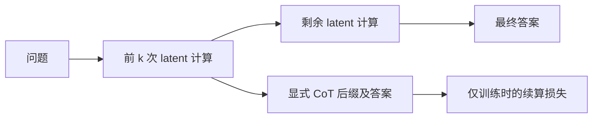

# CODI+latent continuation

核心思路：在codi基础上加一个latent continuation的loss来达到更高的latent推理准确率，这个loss可以理解为在question+latent前缀下预测显式cot后缀

## latent推理和CODI

**什么是latent推理**

Latent 推理（潜在空间推理）是指模型在内部的连续向量表示中完成推理，而不必把每一步都写成可读的文字。传统的文字思维链是“边写步骤边思考”，latent 推理则是“在内部表示中推进思考，最后再输出答案”。它有望减少中间文字生成的开销、提高推理效率，但过程也更难被人理解和检查；此外，并不是模型只要不展示思维链，就算 latent 推理。

- 普通生成：`hidden state → LM head → 采样 token → token embedding → 下一步`
- latent：`hidden state → 直接作为下一步的 embedding → 下一步`

**CODI的思路**

CODI通过自蒸馏同步训练一个教师模型和一个学生模型，完成显式推理能力向隐式的迁移

- **教师路径**：输入问题、预处理后的 CoT 和答案，学习显式推理与答案的交叉熵。
- **学生路径**：读取问题和起始标记，把最后一个隐藏向量经投影器变成下一输入，递归执行 n 次，再生成答案。KV cache 保留此前上下文。
- **蒸馏连接**：在答案前缀的指定位置，比较教师与学生各层隐藏状态。当前采用按教师标准差归一化的 Smooth L1，再对层求平均；教师目标停止梯度，但教师路径另有交叉熵来训练共享参数。

总损失为 `L_CoDi = L_教师文本 + L_学生答案 + L_隐藏状态蒸馏`。这能约束最终答案与终点表示，却没有要求每个中间状态都能支持后续推理。

## latent continuation

学生执行到第 k 个 latent 后，复制当时的 KV cache，接入结束标记，并由**同一个 CoDi 模型**生成显式 CoT 的后缀及答案。训练采用 teacher forcing：给定正确前缀，预测下一个后缀 token。辅助损失的梯度经过缓存回到此前的 latent 计算；复制缓存不等于停止梯度，也不能让辅助分支修改主路径的缓存。

当前总损失为 `L = L_CoDi + 0.3 × L_续算`。

**截点问题**：要进行latent continuation的训练，比较重要的一组参数是latent和显式cot的截点位置（k, r），两者共同决定了从哪个latent开始预测哪一部分的cot后缀。

当前固定组合是 `(k, r) ∈ {(3, 1/3), (4, 1/3), (5, 2/3)}`。每个batch随机一个组合。

初步实验效果

## 待展开实验

### 与coconut对比

为什么比coconut强？

coconut是否存在后续步骤训练会导致前期监督目标丢失的问题

### 截点位置探索

扰动+进化

完全随机

### 续算机制论证

1. 排除模型只是多接受了 CoT 文本训练

2. 检验续算是否真的利用了 latent 状态